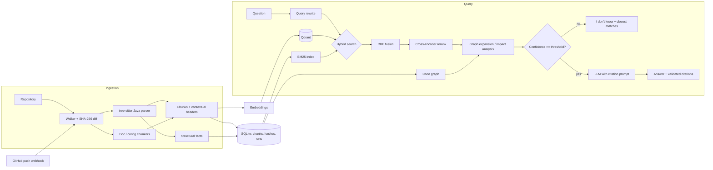

# CodeAtlas

**Retrieval-augmented answers about Java/Spring Boot codebases, with file-and-line citations.**

CodeAtlas indexes a Java repository together with its docs (README, ADRs, Markdown, config) and answers
developer questions such as:

- *"Where is the payment retry logic and what triggers it?"*
- *"Which services call the `/orders/{id}` endpoint?"*
- *"What breaks if I change the `Customer` entity?"*
- *"Explain the auth flow for a new joiner."*

Every answer cites the exact files, methods and doc sections it used, and CodeAtlas answers
*"I don't know based on the indexed code."* when retrieval confidence is too low.

Most RAG demos embed fixed-size text chunks and hope for the best. CodeAtlas parses the code instead: it
understands classes, methods, Spring stereotypes, request mappings, Feign clients and call relationships,
and it measures every retrieval technique against an evaluation set.

## Features

| Area | What it does |
|---|---|
| **Code-aware chunking** | tree-sitter parses Java into class skeletons and method chunks. Each chunk carries a header with package, Spring stereotype (`@RestController`, `@Service`, `@Entity`, `@FeignClient`...), annotations, resolved HTTP endpoints and outgoing calls. |
| **Doc chunking** | Heading-aware Markdown/AsciiDoc sections with breadcrumbs (`Shop > Modules > Orders`), plus config files (`application.yml`, `pom.xml`) and optional PDFs. |
| **Hybrid retrieval** | BM25 with a code tokenizer (splits `findOrderById` and `/orders/{id}`) plus dense vectors in Qdrant, fused with Reciprocal Rank Fusion. |
| **Reranking** | Cross-encoder reranker over the fused candidates; its score also drives the refusal threshold. |
| **Query rewriting** | Optional LLM rewrite of the question into identifier-rich search queries (multi-query + RRF). |
| **Code graph** | NetworkX call/dependency graph: field-type and local-variable call resolution, interface → implementation dispatch, type references. Powers change-impact questions and caller/callee expansion. |
| **Endpoint tracing** | Matches HTTP paths across `@*Mapping` controllers, `@FeignClient` interfaces and URL string literals (`RestTemplate`/`WebClient`). |
| **Grounded generation** | Numbered context blocks, mandatory `[n]` citations, invalid-citation detection and an uncited-sentence count per answer. Works with the Anthropic API, OpenAI(-compatible) or AWS Bedrock. |
| **Incremental indexing** | Content-hash change detection; only changed files are re-chunked and re-embedded. A GitHub webhook re-indexes just the files a push touched. Each run logs files changed, tokens and estimated cost. |
| **Evaluation** | YAML question sets with expected sources. Reports recall@k, hit@k, MRR, latency and, optionally, refusal accuracy, citation precision and LLM-judged faithfulness. Compares configurations side by side. |
| **Observability** | Per-query traces (spans, latency, tokens, cost, retrieved chunks, confidence) written as JSONL. |

## Architecture



## Quickstart

```bash
python -m venv .venv && source .venv/bin/activate      # Windows: .venv\Scripts\activate
pip install -e ".[local,anthropic,dev]"
cp .env.example .env                                     # set CODEATLAS_LLM_MODEL and your API key
codeatlas doctor                                         # Python, index lock, models, LLM config
codeatlas doctor --llm                                   # plus ONE minimal LLM call (billed, 1 token)

# Index the demo repository
git clone https://github.com/spring-projects/spring-petclinic repos/spring-petclinic
codeatlas index repos/spring-petclinic

# Ask questions
codeatlas ask "How does searching for owners by last name work?"
codeatlas ask "What breaks if I change the Owner entity?" --mode hybrid+rerank+graph
codeatlas ask "Where are pets validated?" --sources-only        # retrieval only, no LLM call

# Change-impact analysis straight from the code graph
codeatlas impact Owner
codeatlas impact OwnerController.processFindForm --depth 2

# Run the API
codeatlas serve --port 8000
```

Re-running `codeatlas index` only re-embeds files whose content changed. Use `--force` to rebuild, for
example after switching embedding model.

### Docker

```bash
REPO_PATH=./repos/spring-petclinic docker compose up --build
curl -X POST localhost:8000/api/index -H 'content-type: application/json' -d '{}'
```

## Retrieval modes

Modes are composed with `+`: a base mode (`vector`, `bm25`, `hybrid`) plus any of `rewrite`, `rerank` and
`graph`, e.g. `hybrid+rerank+graph`. Set the default with `CODEATLAS_DEFAULT_MODE`, or pass `--mode` /
`"mode"` per request.

| Flag | Effect |
|---|---|
| `rewrite` | LLM generates up to three extra identifier-rich queries; results are fused with RRF. |
| `rerank` | Cross-encoder rescoring of the top 30 candidates; confidence = sigmoid(top score). |
| `graph` | Boosts chunks that serve or call an HTTP path named in the question. For impact questions ("what breaks", "who calls", "which services call") it resolves the mentioned classes, methods or endpoints in the code graph, walks dependents, and adds a citable dependency report plus the affected code to the context. Otherwise it adds direct callers/callees of the top hits. |

## Evaluation

The evaluation harness is the part that makes the comparisons credible. An eval set is a YAML list of
questions with the sources a correct answer must use:

```yaml
questions:
  - id: owner-search
    question: How does searching for owners by last name work?
    expected_sources:
      - owner/OwnerController.java::OwnerController.processFindForm
      - owner/OwnerRepository.java
  - id: no-kafka
    question: How are Kafka consumer offsets committed?
    answerable: false          # the system should refuse
```

The PetClinic set has 64 questions, with every expected source verified against upstream `main` @
`500158f`: flows and locations, endpoints, callers of endpoints (`redirect:` URLs), change-impact and
caller questions for the code graph, configuration, and 11 questions about things the codebase does not
contain, which the system should refuse. Re-verify if you evaluate a different revision.

It is split, stratified by category, into `eval/petclinic-dev.yaml` (40 questions) and a held-out
`eval/petclinic-test.yaml` (24). Every tuning decision is made on dev only. The test split is run once,
after the setup is frozen, so its numbers are not fitted to it.

**How a retrieved chunk is matched to an expected source.** A file-level source matches any chunk of that
file. A `Class.method` source is first resolved to the method's definition by parsing the repository:
from the declaration (annotations and signature) to the closing brace, without the Javadoc above it. A
chunk matches only if it comes from that file and overlaps the definition by at least
**min(5 lines, half the definition)**. The same rule applies to every chunker, so naive and AST chunks are
scored alike, and a chunk that only grazes a method (its Javadoc, one line, the closing brace) does not
count. A class-outline chunk holds only member signatures, so it counts for its class but not for the
class's methods. A source that no longer exists in the repository fails the run instead of silently
scoring zero.

> History of the rule. (1) The first baseline matched symbols by name, and naive chunks (which have no
> symbol) whenever the method name appeared anywhere in the text, crediting chunks that only *call* a
> method. (2) Matching then became any line overlap with the definition, which left the AST setups
> unchanged but raised the naive baseline (recall@5 0.660 → 0.682 on all 64 questions), because a large
> window touching a method's Javadoc or last line counted. (3) The current rule requires a real overlap
> with the declaration and body. Results from different rules are not comparable.

The comparison is an ablation: each step changes one thing, so each row shows the gain from one technique.

```bash
# 0. Pin the inputs
git -C repos/spring-petclinic checkout 500158f

# 1. Baseline: fixed-size chunks + vector search (separate index)
codeatlas --index-dir .codeatlas-naive index repos/spring-petclinic --chunker naive
codeatlas --index-dir .codeatlas-naive eval eval/petclinic-dev.yaml -k 5 --deep-k 10 --configs vector

# 2-5. AST chunks, then add keyword search, the reranker and the code graph one at a time
codeatlas index repos/spring-petclinic
codeatlas eval eval/petclinic-dev.yaml -k 5 --deep-k 10 --configs vector,hybrid,hybrid+rerank,hybrid+rerank+graph

# Ranking options can be switched per run to measure them, e.g. -o demote_tests=false

# 6. Once the setup is frozen: the held-out test split, then answer quality for the chosen setup
#    (repeat the judged run 2-3 times; judge scores vary)
codeatlas eval eval/petclinic-test.yaml -k 5 --deep-k 10 --configs <frozen setup>
codeatlas eval eval/petclinic-test.yaml -k 5 --configs <frozen setup> --judge
```

Retrieval metrics (recall@k, hit@k, MRR) do not call the LLM, so they are cheap and repeatable. The
LLM-judged metrics are not.

Each run prints the overall and per-category tables and writes a full report to `results/eval-<timestamp>.md`
and `.json` containing:

- **Run metadata:** CodeAtlas and PetClinic commits (flagged `-dirty` if modified), embedding model,
  chunker, reranker, LLM and thresholds, chunk count, graph size, and the index build's files, tokens,
  cost and duration.
- **Overall table:** recall@k, hit@k, MRR, latency and, with `--answers`/`--judge`, refusal accuracy,
  citation precision and faithfulness.
- **Recall by category:** shows *where* a technique helps, for example the graph on the impact and
  endpoint-caller questions.
- **Weakest questions per setup:** expected vs. retrieved sources, for failure analysis.

### Results

Fill this in from the reports above. These are measured numbers, not estimates.

**Run details:** PetClinic `500158f` · CodeAtlas `–` · embeddings `–` · reranker `–` · LLM `–` · k = 5 ·
index build: `–` files, `–` chunks, `–` s, $`–`

| # | Chunking | Retrieval | recall@5 | hit@5 | MRR | p50 latency |
|---|---|---|---|---|---|---|
| 1 | naive | vector | – | – | – | – |
| 2 | AST | vector | – | – | – | – |
| 3 | AST | + BM25 (hybrid) | – | – | – | – |
| 4 | AST | + reranker | – | – | – | – |
| 5 | AST | + code graph | – | – | – | – |

**Recall@5 by category** (rows 2–5): paste the category table from the report.

**Answer quality** (best setup, mean of runs): faithfulness `–` · citation precision `–` · refusal accuracy `–`

**Failure analysis:** two or three concrete examples from the weakest-questions section, such as a question
the graph answers that vector search misses.

## HTTP API

| Method | Path | Purpose |
|---|---|---|
| `POST` | `/api/ask` | `{"question", "mode"?, "k"?}` → answer, citations, sources, confidence, usage, trace id |
| `POST` | `/api/ask/stream` | Same, as server-sent events: `sources`, `token`..., `done` |
| `GET` | `/api/impact?symbol=Owner&depth=3` | Dependents of a class or method from the code graph |
| `GET` | `/api/file?path=...&start=&end=` | Source lines for the citation viewer (path-traversal safe) |
| `POST` | `/api/index` | `{"repo_path"?, "force"?}` — start an index run in the background |
| `GET` | `/api/index/runs` | Index run history: files changed, chunks, tokens, cost, duration |
| `POST` | `/api/webhook/github` | GitHub push webhook (HMAC-verified) → targeted re-index |
| `GET` | `/api/stats`, `/health` | Index and graph statistics, liveness |

### Incremental indexing via webhook

1. Set `CODEATLAS_WEBHOOK_SECRET` (and optionally `CODEATLAS_WEBHOOK_BRANCH`, `CODEATLAS_GIT_PULL_ON_WEBHOOK=true`).
2. Add a GitHub webhook for `push` events pointing at `/api/webhook/github` with the same secret.
3. On each push, CodeAtlas pulls (optionally), re-chunks and re-embeds only the added/modified files, and
   removes deleted ones. Large or force pushes fall back to a full hash-based scan, which still skips
   unchanged files.

## Configuration

All settings are environment variables prefixed with `CODEATLAS_` (or entries in `.env`). See
[.env.example](.env.example).

| Setting | Default | Notes |
|---|---|---|
| `INDEX_DIR` | `.codeatlas` | SQLite store, embedded Qdrant and `traces.jsonl` |
| `QDRANT_URL` | embedded | Set to a Qdrant server URL for the API/Docker setup |
| `EMBEDDING_PROVIDER` / `EMBEDDING_MODEL` | `local` / `BAAI/bge-small-en-v1.5` | `openai`, `voyage` (e.g. `voyage-code-3`) or `hashing` (offline) |
| `RERANKER_MODEL` | `cross-encoder/ms-marco-MiniLM-L-6-v2` | Empty disables reranking |
| `LLM_PROVIDER` / `LLM_MODEL` | `anthropic` / – | `openai` (with `LLM_BASE_URL` for compatible servers) or `bedrock` |
| `DEFAULT_MODE` | `hybrid+graph` | Any mode spec |
| `MIN_VECTOR_SIMILARITY` | `0.30` | Refusal threshold without reranking |
| `MIN_RERANK_CONFIDENCE` | `0.05` | Refusal threshold with reranking; tune with the unanswerable eval questions |
| `LLM_PRICES` | none | JSON prices per `"<provider>:<model>"` (`input_per_mtok`, `output_per_mtok`); Bedrock and the Anthropic API are separate entries. Unlisted models report cost as `unpriced`, never $0. Eval reports sum answer and judge cost |
| `EMBEDDING_COST_PER_MTOK` | `0` | Price used for index-run embedding cost |

## Project layout

```
codeatlas/
  ingest/      walker, tree-sitter Java parser, doc/naive chunkers, incremental indexer
  storage/     SQLite chunk store, Qdrant vector store
  retrieval/   code tokenizer, BM25, cross-encoder reranker, query rewriter, hybrid retriever
  graph.py     call/dependency graph and impact analysis
  answer.py    prompting, citation validation, refusal
  llm.py       Anthropic / OpenAI / Bedrock providers
  eval/        datasets, metrics, LLM judge, comparison runner
  api/         FastAPI app and GitHub webhook
  cli.py       `codeatlas` command
eval/          evaluation sets
tests/         pytest suite with a small Spring Boot fixture repository
```

## Development

```bash
pip install -e ".[dev]"
ruff check .
pytest
```

The test suite runs fully offline: it uses the hashing embedder, in-memory Qdrant and a fake LLM against
the fixture repository in `tests/fixtures/shop`.

## Limitations

- The call graph is static and name-based. It does not see reflection, Spring events, AOP proxies or
  beans wired only in configuration, and overloaded methods share a node.
- Endpoint matching covers Spring MVC annotations, Feign clients and URL string literals. It does not
  cover URLs built at runtime or read from configuration.

## Roadmap

- React + TypeScript chat UI with clickable citations and a code viewer (the API already exposes
  `/api/ask/stream` and `/api/file`)
- OpenTelemetry / Langfuse trace export
- AWS deployment (ECS + S3) with Terraform
- Neo4j backend for very large graphs; Kotlin support

## License

MIT
