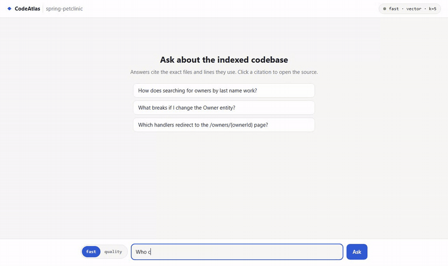
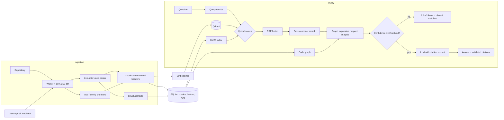

# CodeAtlas

**Ask questions about a Java/Spring Boot codebase and get answers that cite the exact files and lines.**



*Retrieval demo (offline LLM): a `fast` answer, the same impact question in `quality` mode with its progress bar, a citation opening the source viewer, and an "I don't know" refusal. Answers come from the offline stand-in, so they only cite the retrieved blocks. Retrieval, citations and refusal are real.*

**Held-out test result** vs a naive fixed-size-chunk vector baseline: **recall@5 0.70 → 0.81**,
**MRR 0.63 → 0.70**, **impact-question recall 0.42 → 0.85** ([details](#results)).

[](https://github.com/aakashsiwach/codeatlas-rag/actions/workflows/ci.yml)
[](pyproject.toml)
[](LICENSE)

CodeAtlas indexes a Java repository together with its docs and config, and answers developer questions
such as:

- *"How does searching for owners by last name work?"*
- *"Which handlers redirect to the `/owners/{ownerId}` page?"*
- *"What breaks if I change the `Owner` entity?"*

Every answer cites the code blocks it used. When retrieval finds nothing relevant, CodeAtlas says
*"I don't know based on the indexed code."* and shows the closest matches. Each retrieval technique is
measured against an evaluation set with a held-out test split.

## Project status

CodeAtlas is **feature-complete** and **maintained on a best-effort basis**. Issues and pull requests are
welcome; see [Contributing](#contributing) and the open work in [ROADMAP.md](ROADMAP.md).

Two parts of the original plan were **not run**:

- **Answer-quality evaluation** (LLM-judged faithfulness, citation precision and refusal accuracy). The
  64 reference answers have not been reviewed, and no judged run was made. The harness is ready:
  [`scripts/run-judge.ps1`](scripts/run-judge.ps1) / [`scripts/run-judge.sh`](scripts/run-judge.sh) refuse
  unreviewed references, estimate the cost against a budget and ask before spending.
- **A live AWS deployment.** The [Terraform](infra/terraform) for ECS Fargate behind CloudFront passes
  `terraform validate` in CI but has never been applied. [docs/deploy.md](docs/deploy.md) walks through a
  short demo session and its teardown.

Both are ready for anyone with model access (Amazon Bedrock, the Anthropic API or a local Ollama model).
Every number in this README is a retrieval measurement from a committed report.

## How it works



**AST chunking.** tree-sitter parses each Java file into a class outline (fields and member signatures)
and one chunk per method, cut at real declaration boundaries instead of every N lines. Each chunk gets a
header with its package, Spring stereotype (`@RestController`, `@Service`, `@Entity`...), annotations,
resolved HTTP endpoints and outgoing calls. The header is embedded with the code, so a question about
"the owners endpoint" can match a method whose body never says "owner". Docs are split by heading, and
config files (`application.properties`, SQL schemas) are indexed whole.

**Hybrid search.** BM25 with a code-aware tokenizer (it splits `findByLastName` and `/owners/{id}`) finds
exact identifiers. Dense vectors (`bge-small-en-v1.5` in Qdrant) find paraphrases. Reciprocal Rank Fusion
merges the two lists. Test code is ranked below main code, and class outlines below their own methods.

**Reranker.** A cross-encoder (`gte-reranker-modernbert-base`) rescores the top 20 fused candidates by
reading the question and each chunk together. It gave the largest single gain on dev, and its score is the
confidence used for refusals. It costs about 25–30 s per question on a laptop CPU, so it is opt-in: the
`quality` setup.

**Code graph.** The parse facts build a NetworkX graph:
- calls, resolved through field and local-variable types
- interface → implementation dispatch
- type references
- which code calls which HTTP endpoint (`redirect:` URLs, Feign clients, URL literals)

For impact questions ("what breaks if I change X", "who calls Y"), CodeAtlas resolves the classes, methods
or endpoints the question names. It then walks their dependents and adds a citable dependency report to
the context. Two of the top five slots are reserved for graph neighbours.

**Citations and refusal.** The retrieved chunks go to the LLM as numbered blocks, and the prompt requires
`[n]` citations. Citations to blocks that were not retrieved are flagged. If the retrieval confidence is
below a threshold calibrated on the dev split, CodeAtlas refuses before calling the LLM at all. The prompt
also tells the LLM to answer "I don't know" when the blocks do not contain the answer. The two safeguards
complement each other, because the confidence margin is thin (see [Limitations](#limitations)).

**Incremental indexing.** Every file is hashed (SHA-256), and a re-index only re-chunks and re-embeds the
files whose content changed. A GitHub push webhook re-indexes just the files a push touched. Each run
records the files changed, the tokens embedded, the estimated cost and the duration.

## Features

| Area | What it does |
|---|---|
| **Code-aware chunking** | tree-sitter parses Java into class skeletons and method chunks. Each chunk carries a header with package, Spring stereotype (`@RestController`, `@Service`, `@Entity`, `@FeignClient`...), annotations, resolved HTTP endpoints and outgoing calls. |
| **Doc chunking** | Heading-aware Markdown/AsciiDoc sections with breadcrumbs (`Shop > Modules > Orders`), plus config files (`application.yml`, `pom.xml`) and optional PDFs. |
| **Hybrid retrieval** | BM25 with a code tokenizer (splits `findOrderById` and `/orders/{id}`) plus dense vectors in Qdrant, fused with Reciprocal Rank Fusion. |
| **Reranking** | Cross-encoder reranker over the fused candidates; its score also drives the refusal threshold. |
| **Query rewriting** | Optional LLM rewrite of the question into identifier-rich search queries (multi-query + RRF). |
| **Code graph** | NetworkX call/dependency graph: field-type and local-variable call resolution, interface → implementation dispatch, type references. Powers change-impact questions and caller/callee expansion. |
| **Endpoint tracing** | Matches HTTP paths across `@*Mapping` controllers, `@FeignClient` interfaces and URL string literals (`RestTemplate`/`WebClient`). |
| **Grounded generation** | Numbered context blocks, mandatory `[n]` citations, invalid-citation detection and an uncited-sentence count per answer. Works with the Anthropic API, OpenAI(-compatible, e.g. Ollama) or AWS Bedrock, plus an offline `fake` provider for demos and tests. |
| **Incremental indexing** | Content-hash change detection; only changed files are re-chunked and re-embedded. A GitHub webhook re-indexes just the files a push touched. Each run logs files changed, tokens and estimated cost. |
| **Evaluation** | YAML question sets with expected sources and a held-out test split. Reports recall@k, hit@k, MRR, latency and, optionally, refusal accuracy, citation precision and LLM-judged faithfulness. Compares configurations side by side. |
| **Web UI** | Streaming chat with clickable citations, a source viewer, a "don't know" state and a per-question `fast` / `quality` switch. |
| **Observability** | Per-query traces (spans, latency, tokens, cost, retrieved chunks, confidence) written as JSONL. |

## Quickstart

You need Python 3.11+ on PATH, Git, and Node 24 or newer for the web UI. The first `index` downloads the embedding model
(~130 MB), and the first `quality` question downloads the reranker (~600 MB). The commands below make no
paid calls: `CODEATLAS_LLM_PROVIDER=fake` is an offline stand-in that cites the retrieved blocks without
calling a model. Swap it for [Ollama](#real-answers-with-ollama-local-free) or
[Bedrock](#real-answers-with-amazon-bedrock) for real answers.

**Fastest path.** After installing (first two steps of either block below), one command clones PetClinic
at the evaluated revision if it is missing, indexes it, builds the UI and serves everything on
http://127.0.0.1:8000 with the offline LLM:

```bash
codeatlas demo
```

**Windows (PowerShell)**

```powershell
git clone https://github.com/aakashsiwach/codeatlas-rag
cd codeatlas-rag
python -m venv .venv
.venv\Scripts\Activate.ps1        # if blocked: Set-ExecutionPolicy -Scope Process Bypass
pip install -e ".[local,openai,bedrock,dev]"

# Index the demo repository at the evaluated revision
git clone https://github.com/spring-projects/spring-petclinic repos/spring-petclinic
git -C repos/spring-petclinic checkout 500158f
codeatlas index repos/spring-petclinic

# Ask with the offline fake LLM
$env:CODEATLAS_LLM_PROVIDER = "fake"
codeatlas doctor --skip-models
codeatlas ask "How does searching for owners by last name work?"
codeatlas ask "What breaks if I change the Owner entity?" --mode hybrid+rerank+graph
codeatlas ask "Where are pets validated?" --sources-only     # retrieval only
codeatlas impact Owner                                         # change impact from the code graph
```

**macOS / Linux (bash or zsh)**

```bash
git clone https://github.com/aakashsiwach/codeatlas-rag
cd codeatlas-rag
python3 -m venv .venv
source .venv/bin/activate
pip install -e ".[local,openai,bedrock,dev]"

# Index the demo repository at the evaluated revision
git clone https://github.com/spring-projects/spring-petclinic repos/spring-petclinic
git -C repos/spring-petclinic checkout 500158f
codeatlas index repos/spring-petclinic

# Ask with the offline fake LLM
export CODEATLAS_LLM_PROVIDER=fake
codeatlas doctor --skip-models
codeatlas ask "How does searching for owners by last name work?"
codeatlas ask "What breaks if I change the Owner entity?" --mode hybrid+rerank+graph
codeatlas ask "Where are pets validated?" --sources-only     # retrieval only
codeatlas impact Owner                                         # change impact from the code graph
```

Re-running `codeatlas index` only re-embeds files whose content changed. Use `--force` to rebuild it,
for example after switching embedding model. For settings that persist, copy `.env.example` to `.env`.

### Web UI

Start the API in one terminal and the UI in another, then open **http://localhost:5173**.

```powershell
codeatlas serve --port 8000                  # terminal 1, with $env:CODEATLAS_LLM_PROVIDER set as above
cd ui; npm install; npm run dev              # terminal 2
```
```bash
codeatlas serve --port 8000                  # terminal 1, with CODEATLAS_LLM_PROVIDER exported as above
cd ui && npm install && npm run dev          # terminal 2
```

### Real answers with Ollama (local, free)

Ollama's OpenAI-compatible endpoint works through the `openai` provider. These commands follow Ollama's
documented setup, but unlike the blocks above they are not run by CI or by the release checks. Raise Ollama's context window:
its default can be smaller than CodeAtlas's prompt (instructions plus five code blocks), and Ollama
truncates the prompt silently.

```powershell
ollama pull qwen2.5-coder:7b
$env:OLLAMA_CONTEXT_LENGTH = "8192"; ollama serve       # in its own terminal, if Ollama is not running
$env:CODEATLAS_LLM_PROVIDER = "openai"
$env:CODEATLAS_LLM_MODEL    = "qwen2.5-coder:7b"
$env:CODEATLAS_LLM_BASE_URL = "http://localhost:11434/v1"
$env:OPENAI_API_KEY         = "ollama"                  # the SDK needs a value; Ollama ignores it
codeatlas ask "How does searching for owners by last name work?"
```
```bash
ollama pull qwen2.5-coder:7b
OLLAMA_CONTEXT_LENGTH=8192 ollama serve                 # in its own terminal, if Ollama is not running
export CODEATLAS_LLM_PROVIDER=openai CODEATLAS_LLM_MODEL=qwen2.5-coder:7b
export CODEATLAS_LLM_BASE_URL=http://localhost:11434/v1 OPENAI_API_KEY=ollama
codeatlas ask "How does searching for owners by last name work?"
```

### Real answers with Amazon Bedrock

You need model access for the model in your AWS account. Like the Ollama commands, these are not run by
CI, because Bedrock calls are billed. Credentials come from a named profile in
`~/.aws`, never from `.env`. Bedrock bills every call, including the 1-token `doctor --llm` check.

```powershell
$env:CODEATLAS_LLM_PROVIDER = "bedrock"
$env:CODEATLAS_LLM_MODEL    = "global.anthropic.claude-sonnet-5-5"
$env:CODEATLAS_AWS_REGION   = "us-east-1"
$env:CODEATLAS_AWS_PROFILE  = "codeatlas"               # your profile name
codeatlas doctor --llm                                  # ONE 1-token call
codeatlas ask "How does searching for owners by last name work?"
```
```bash
export CODEATLAS_LLM_PROVIDER=bedrock CODEATLAS_LLM_MODEL=global.anthropic.claude-sonnet-5-5
export CODEATLAS_AWS_REGION=us-east-1 CODEATLAS_AWS_PROFILE=codeatlas
codeatlas doctor --llm                                  # ONE 1-token call
codeatlas ask "How does searching for owners by last name work?"
```

Set `CODEATLAS_LLM_PRICES` (see `.env.example`) so that answers and eval reports show cost. A model
without a price shows "unpriced", never $0. The Anthropic API works the same way, with
`CODEATLAS_LLM_PROVIDER=anthropic` and `ANTHROPIC_API_KEY`.

### Docker

```bash
REPO_PATH=./repos/spring-petclinic docker compose up --build      # API + UI on http://127.0.0.1:8000
curl -X POST localhost:8000/api/index -H 'content-type: application/json' -d '{}'
```

To deploy to AWS (ECS Fargate behind CloudFront, Terraform), see [docs/deploy.md](docs/deploy.md).

## Documentation

| Guide | What it covers |
|---|---|
| [Architecture](docs/architecture.md) | Components, the ingestion and query paths, named setups |
| [Evaluation](docs/evaluation.md) | Question set, scoring rule, dev/test split, and how to reproduce every number below |
| [Configuration](docs/configuration.md) | Every `CODEATLAS_*` setting with its default (generated from the code) |
| [HTTP API](docs/api.md) | Endpoints, authentication, server-sent events; [openapi.json](docs/openapi.json) |
| [Deploy to AWS](docs/deploy.md) | ECS Fargate + CloudFront with Terraform, a demo session and its cost, teardown |
| [Troubleshooting](docs/troubleshooting.md) | Index lock, Windows paths, provider errors and what they mean |
| [Contributing](CONTRIBUTING.md) · [Security](SECURITY.md) · [Changelog](CHANGELOG.md) | How to help, how to report a vulnerability, what changed |

## Retrieval modes

Modes are composed with `+`: a base mode (`vector`, `bm25`, `hybrid`) plus any of `rewrite`, `rerank` and
`graph`, e.g. `hybrid+rerank+graph`. Set the default with `CODEATLAS_DEFAULT_MODE`, or pass `--mode` /
`"mode"` per request.

| Flag | Effect |
|---|---|
| `rewrite` | LLM generates up to three extra identifier-rich queries; results are fused with RRF. |
| `rerank` | Cross-encoder rescoring of the top 20 candidates; confidence = sigmoid(top score). |
| `graph` | Boosts chunks that serve or call an HTTP path named in the question. For impact questions ("what breaks", "who calls", "which services call") it resolves the mentioned classes, methods or endpoints in the code graph, walks dependents, and adds a citable dependency report plus the affected code to the context. Otherwise it adds direct callers/callees of the top hits. |

## Evaluation

The evaluation harness is the part that makes the comparisons credible. An eval set is a YAML list of
questions with the sources a correct answer must use:

```yaml
questions:
  - id: owner-search
    question: How does searching for owners by last name work?
    expected_sources:
      - owner/OwnerController.java::OwnerController.processFindForm
      - owner/OwnerRepository.java
  - id: no-kafka
    question: How are Kafka consumer offsets committed?
    answerable: false          # the system should refuse
```

The PetClinic set has 64 questions, with every expected source verified against upstream `main` @
`500158f`: flows and locations, endpoints, callers of endpoints (`redirect:` URLs), change-impact and
caller questions for the code graph, configuration, and 11 questions about things the codebase does not
contain, which the system should refuse. Re-verify if you evaluate a different revision.

It is split, stratified by category, into `eval/petclinic-dev.yaml` (40 questions) and a held-out
`eval/petclinic-test.yaml` (24). Every tuning decision is made on dev only. The test split is run once,
after the setup is frozen, so its numbers are not fitted to it.

**How a retrieved chunk is matched to an expected source.** A file-level source matches any chunk of that
file. A `Class.method` source is first resolved to the method's definition by parsing the repository:
from the declaration (annotations and signature) to the closing brace, without the Javadoc above it. A
chunk matches only if it comes from that file and overlaps the definition by at least
**min(5 lines, half the definition)**. The same rule applies to every chunker, so naive and AST chunks are
scored alike, and a chunk that only grazes a method (its Javadoc, one line, the closing brace) does not
count. A class-outline chunk holds only member signatures, so it counts for its class but not for the
class's methods. A source that no longer exists in the repository fails the run instead of silently
scoring zero.

> History of the rule. (1) The first baseline matched symbols by name, and naive chunks (which have no
> symbol) whenever the method name appeared anywhere in the text, crediting chunks that only *call* a
> method. (2) Matching then became any line overlap with the definition, which left the AST setups
> unchanged but raised the naive baseline (recall@5 0.660 → 0.682 on all 64 questions), because a large
> window touching a method's Javadoc or last line counted. (3) The current rule requires a real overlap
> with the declaration and body. Results from different rules are not comparable.

The comparison is an ablation: each step changes one thing, so each row shows the gain from one technique.

```bash
# 0. Pin the inputs
git -C repos/spring-petclinic checkout 500158f

# 1. Baseline: fixed-size chunks + vector search (separate index)
codeatlas --index-dir .codeatlas-naive index repos/spring-petclinic --chunker naive
codeatlas --index-dir .codeatlas-naive eval eval/petclinic-dev.yaml -k 5 --deep-k 10 --configs vector

# 2-5. AST chunks, then add keyword search, the reranker and the code graph one at a time
codeatlas index repos/spring-petclinic
codeatlas eval eval/petclinic-dev.yaml -k 5 --deep-k 10 --configs vector,hybrid,hybrid+rerank,hybrid+rerank+graph

# Ranking options can be switched per run to measure them, e.g. -o demote_tests=false

# 6. Once the setup is frozen: the held-out test split, then answer quality for the chosen setup
#    (repeat the judged run 2-3 times; judge scores vary)
codeatlas eval eval/petclinic-test.yaml -k 5 --deep-k 10 --configs vector,hybrid+rerank+graph --final
codeatlas eval eval/petclinic-test.yaml -k 5 --configs hybrid+rerank+graph --judge --final
# or: scripts/run-judge.ps1 / scripts/run-judge.sh (reviewed-references gate, cost estimate vs
#     a budget, confirmation, N passes, then the answer-quality table)
```

Retrieval metrics (recall@k, hit@k, MRR) do not call the LLM, so they are cheap and repeatable. The
LLM-judged metrics are not.

Each run prints the overall and per-category tables and writes a full report to `results/eval-<timestamp>.md`
and `.json` containing:

- **Run metadata:** CodeAtlas and PetClinic commits (flagged `-dirty` if modified), embedding model,
  chunker, reranker, LLM and thresholds, chunk count, graph size, and the index build's files, tokens,
  cost and duration.
- **Overall table:** recall@k, hit@k, MRR, latency and, with `--answers`/`--judge`, refusal accuracy,
  citation precision and faithfulness.
- **Recall by category:** shows *where* a technique helps, for example the graph on the impact and
  endpoint-caller questions.
- **Weakest questions per setup:** expected vs. retrieved sources, for failure analysis.

[docs/evaluation.md](docs/evaluation.md) lists the exact command and commit behind every number in this
section.

### Frozen setups

Frozen on the dev split before the test split was run; nothing below changed after seeing test numbers.
Both use AST chunks, `bge-small-en-v1.5` embeddings and k = 5, with test code ranked below main code and
class outlines below their methods.

| Setup | Mode | Reranker | Refusal threshold | Dev recall@5 | recall@10 | hit@5 | MRR | p50 |
|---|---|---|---|---|---|---|---|---|
| **fast** (API/UI default) | `vector` | none | vector similarity 0.6177 | 0.816 | 0.919 | 1.000 | 0.665 | 27 ms |
| **quality** | `hybrid+rerank+graph` | `Alibaba-NLP/gte-reranker-modernbert-base`, top 20 candidates | rerank score 0.868 | 0.894 | 0.967 | 1.000 | 0.791 | 27 s (CPU) |

`quality` reserves 2 of the top 5 for code-graph neighbours (`graph_slots=2`). `fast` is the best dev
setup without a reranker (hybrid without the reranker: recall@5 0.808, hit@5 0.970). The thresholds are
the balanced-accuracy optimum on dev (`--calibrate`), from only 7 unanswerable dev questions. These are
the code defaults, so neither needs extra options:

```bash
codeatlas ask "..."                                   # fast
codeatlas ask "..." --mode hybrid+rerank+graph        # quality
codeatlas eval eval/petclinic-test.yaml -k 5 --deep-k 10 --configs vector,hybrid+rerank+graph --final
```

### Results

Held-out test split, retrieval only (no LLM calls). Measured numbers from
`results/eval-20261113-183425` (baseline) and `results/eval-20261113-174905` (fast, quality).

**Run details:** PetClinic `500158f` · CodeAtlas `72143e2` · embeddings `BAAI/bge-small-en-v1.5` (local) ·
reranker `Alibaba-NLP/gte-reranker-modernbert-base` (quality only) · k = 5 · index build: 83 files,
327 AST chunks in 128 s (naive: 188 chunks in 93 s), $0 (local embeddings) · CPU only

| Setup | Config | recall@5 | recall@10 | hit@5 | MRR | p50 latency |
|---|---|---|---|---|---|---|
| baseline | naive fixed-size chunks, `vector` | 0.704 | 0.904 | 0.850 | 0.627 | 25 ms |
| fast | AST chunks, `vector`, threshold 0.6177 | 0.713 | 0.850 | 0.800 | 0.554 | 35 ms |
| quality | AST chunks, `hybrid+rerank+graph`, ModernBERT over 20 candidates, 2 graph slots, threshold 0.868 | 0.812 | 0.887 | 0.900 | 0.702 | 32.7 s |

All three use the same ranking defaults (test code below main code, class outlines below their methods);
the frozen configs are described in [Frozen setups](#frozen-setups), and the baseline is the
pre-declared step 1 above, untuned.

**Recall@5 by category**

| category (test questions) | baseline | fast | quality |
|---|---|---|---|
| config (2) | 0.500 | 0.500 | 0.500 |
| endpoint (3) | 1.000 | 0.667 | 1.000 |
| endpoint-callers (2) | 1.000 | 1.000 | 1.000 |
| flow (4) | 0.875 | 0.750 | 0.750 |
| impact (5) | 0.417 | 0.650 | 0.850 |
| locate (3) | 0.667 | 0.667 | 0.667 |
| model (1) | 0.500 | 1.000 | 1.000 |

The test split has 24 questions (20 answerable, 1-5 per category), so per-category numbers are indicative
only.

**Honest findings**

- **AST chunking alone did not help on the test split.** Fast (AST chunks + vector) scored recall@5 0.713,
  against 0.704 for the naive baseline, with *lower* hit@5 (0.800 vs 0.850) and MRR (0.554 vs 0.627).
  The +0.06 recall@5 it gained on dev did not hold up. The measured gains come from the reranker and the
  code graph.
- **Both frozen setups scored 0.08–0.10 lower on test than on dev.** That is the cost of tuning on dev,
  enlarged by small samples: one question moves hit@5 by 0.05.
- **The first reranker hurt.** `ms-marco-MiniLM-L-6-v2` lowered dev recall@5 from 0.808 (hybrid) to 0.745
  and was replaced by ModernBERT.
- **Quality costs about 1,000× the latency** of fast on CPU (32.7 s vs 35 ms p50 on test).

**Answer quality** (quality setup, mean of 2-3 judged runs): not run (see [Project status](#project-status)).

**Failure analysis:** not run; it comes with the judged runs.

## HTTP API

Full reference: [docs/api.md](docs/api.md).

| Method | Path | Purpose |
|---|---|---|
| `POST` | `/api/ask` | `{"question", "setup"?}` (`fast` or `quality`) or `{"question", "mode"?, "k"?}` → answer, citations, sources, confidence, usage, setup, timings (retrieval and total ms), trace id |
| `POST` | `/api/ask/stream` | Same, as server-sent events: `progress` (at once, then every 5 s while working, so proxies such as CloudFront never wait for a first byte), `sources`, `token`..., `done` |
| `GET` | `/api/impact?symbol=Owner&depth=3` | Dependents of a class or method from the code graph |
| `GET` | `/api/file?path=...&start=&end=` | Source lines for the citation viewer (path-traversal safe) |
| `POST` | `/api/index` | `{"repo_path"?, "force"?}` — start an index run in the background |
| `GET` | `/api/index/runs` | Index run history: files changed, chunks, tokens, cost, duration |
| `POST` | `/api/webhook/github` | GitHub push webhook (HMAC-verified) → targeted re-index |
| `GET` | `/api/config` | The active setup for the UI: named setups, models, thresholds (no secrets) |
| `GET` | `/api/stats`, `/health` | Index and graph statistics, liveness |

### Incremental indexing via webhook

1. Set `CODEATLAS_WEBHOOK_SECRET` (and optionally `CODEATLAS_WEBHOOK_BRANCH`, `CODEATLAS_GIT_PULL_ON_WEBHOOK=true`).
2. Add a GitHub webhook for `push` events pointing at `/api/webhook/github` with the same secret.
3. On each push, CodeAtlas pulls (optionally), re-chunks and re-embeds only the added/modified files, and
   removes deleted ones. Large or force pushes fall back to a full hash-based scan, which still skips
   unchanged files.

## Web UI

`ui/` is a React + TypeScript chat client (Vite) for the HTTP API: answers stream in token by token,
numbered citations open a source viewer with the cited lines highlighted, low-confidence questions show a
"don't know" card with the closest matches, and a settings panel shows the active setup (setups,
embeddings, reranker, LLM, refusal thresholds, ranking options) and takes an API token. A switch next to
the question box picks the setup per question: `fast` (the default) or `quality`, sent to the API as
`setup`. Each answer shows the setup it used and its retrieval and total latency, and a `quality` question
shows a progress bar while it retrieves (about 30 s on CPU). A custom mode and k in Settings override the
switch for experiments.

```bash
codeatlas serve --port 8000          # the API (Node 24 or newer for the UI)
cd ui
npm install
npm run dev                          # http://127.0.0.1:5173, proxies /api to 127.0.0.1:8000
```

Set `CODEATLAS_API` to point the dev server at another API address. To try the UI without an LLM, run
the API with `CODEATLAS_LLM_PROVIDER=fake`: an offline provider that cites the retrieved blocks without
calling any model.

```bash
npm test                             # unit tests (Vitest)
npx playwright install chromium      # once
npm run e2e                          # end-to-end smoke test: API on the fixture repo with the offline LLM
```

The end-to-end test starts its own API (`ui/e2e/serve_fixture.py`, hashing embeddings, in-memory vector
store, offline LLM: no network or keys) and the dev server. It uses `../.venv` unless `CODEATLAS_PYTHON`
names another interpreter; `SCREENSHOTS_DIR=screenshots npm run e2e` also saves screenshots.

## Configuration

All settings are environment variables prefixed with `CODEATLAS_` (or entries in `.env`). See
[.env.example](.env.example) to start, and [docs/configuration.md](docs/configuration.md) for every
setting. The most important ones:

| Setting | Default | Notes |
|---|---|---|
| `INDEX_DIR` | `.codeatlas` | SQLite store, embedded Qdrant and `traces.jsonl` |
| `QDRANT_URL` | embedded | Set to a Qdrant server URL for the API/Docker setup |
| `EMBEDDING_PROVIDER` / `EMBEDDING_MODEL` | `local` / `BAAI/bge-small-en-v1.5` | `openai`, `voyage` (e.g. `voyage-code-3`) or `hashing` (offline) |
| `RERANKER_MODEL` | `Alibaba-NLP/gte-reranker-modernbert-base` | Used by `+rerank` modes; empty disables reranking. ~0.6 GB download, slow on CPU (~27 s/query) |
| `LLM_PROVIDER` / `LLM_MODEL` | `anthropic` / – | `openai` (with `LLM_BASE_URL` for compatible servers) or `bedrock` |
| `DEFAULT_MODE` / `DEFAULT_K` | `vector` / `5` | Any mode spec; `vector` is the frozen `fast` setup, `hybrid+rerank+graph` the `quality` one |
| `MIN_VECTOR_SIMILARITY` | `0.30` | Refusal threshold without reranking |
| `MIN_RERANK_CONFIDENCE` | `0.05` | Refusal threshold with reranking; tune with the unanswerable eval questions |
| `MIN_CONFIDENCE_BY_MODEL` | bge-small `0.6177`, ModernBERT `0.868` | JSON per embedder or reranker model, overriding the two above; calibrate on dev with `codeatlas eval … --calibrate`. The code graph never raises confidence |
| `LLM_PRICES` | none | JSON prices per `"<provider>:<model>"` (`input_per_mtok`, `output_per_mtok`); Bedrock and the Anthropic API are separate entries. Unlisted models report cost as `unpriced`, never $0. Eval reports sum answer and judge cost |
| `EMBEDDING_COST_PER_MTOK` | `0` | Price used for index-run embedding cost |

## Project layout

```
codeatlas/
  ingest/      walker, tree-sitter Java parser, doc/naive chunkers, incremental indexer
  storage/     SQLite chunk store, Qdrant vector store
  retrieval/   code tokenizer, BM25, cross-encoder reranker, query rewriter, hybrid retriever
  graph.py     call/dependency graph and impact analysis
  answer.py    prompting, citation validation, refusal
  llm.py       Anthropic / OpenAI / Bedrock / offline providers, errors, prices
  eval/        datasets, metrics, LLM judge, comparison runner, judged-run helpers
  api/         FastAPI app and GitHub webhook
  cli.py       `codeatlas` command;  demo.py: `codeatlas demo`;  doctor.py: `codeatlas doctor`
eval/          evaluation sets (PetClinic dev and held-out test splits)
results/       committed evaluation reports behind the README numbers
ui/            React chat client (Vite) with Vitest and Playwright tests
docs/          architecture, evaluation, configuration, API, deployment, troubleshooting
infra/         Terraform for ECS Fargate + CloudFront + Bedrock
scripts/       judged-run scripts, doc generators, demo GIF tooling
tests/         pytest suite with a small Spring Boot fixture repository
```

## Development

```bash
pip install -c requirements-lock.txt -e ".[local,openai,bedrock,dev]"
make check            # Windows: ./tasks.ps1 check  (ruff, pytest, UI type check and unit tests)
```

See [CONTRIBUTING.md](CONTRIBUTING.md) for the end-to-end test, the generated files and the evaluation rules.

The test suite runs fully offline: it uses the hashing embedder, in-memory Qdrant and a fake LLM against
the fixture repository in `tests/fixtures/shop`.

## Limitations

- The call graph is static and name-based. It does not see reflection, Spring events, AOP proxies or
  beans wired only in configuration, and overloaded methods share a node.
- Endpoint matching covers Spring MVC annotations, Feign clients and URL string literals. It does not
  cover URLs built at runtime or read from configuration.
- Refusing on retrieval confidence has a thin margin: the confidence ranges of answerable and unanswerable
  questions overlap. On dev, ModernBERT rerank scores were 0.834-0.961 for answerable and 0.489-0.866 for
  unanswerable questions, so the 0.868 threshold also refuses 4 of 33 answerable ones. Vector similarity
  overlaps more (0.620-0.797 vs 0.594-0.764): at 0.6177, fast refuses only 4 of 7 unanswerable questions.
  The thresholds also rest on just 7 unanswerable dev questions. The second safeguard is the LLM itself:
  the prompt requires answers grounded in the retrieved blocks and an explicit "I don't know" when they
  do not contain the answer.

## Roadmap

Open work, each item labelled *good first issue*, *help wanted* or *advanced*, is in
[ROADMAP.md](ROADMAP.md). The main items: judged answer-quality runs on a real model, the four deferred
retrieval fixes from the review, graph reports ordered by relevance, a faster quality setup, a
cross-service (Feign) evaluation set and a larger evaluation set.

## Contributing

Contributions are welcome: bug reports, evaluation questions, fixes and the roadmap items above.
[CONTRIBUTING.md](CONTRIBUTING.md) covers the setup, the checks CI runs, the evaluation rules (tune on dev,
never edit the test split to improve numbers) and how a first pull request works. Security problems go
through private reporting ([SECURITY.md](SECURITY.md)).

## License

MIT
