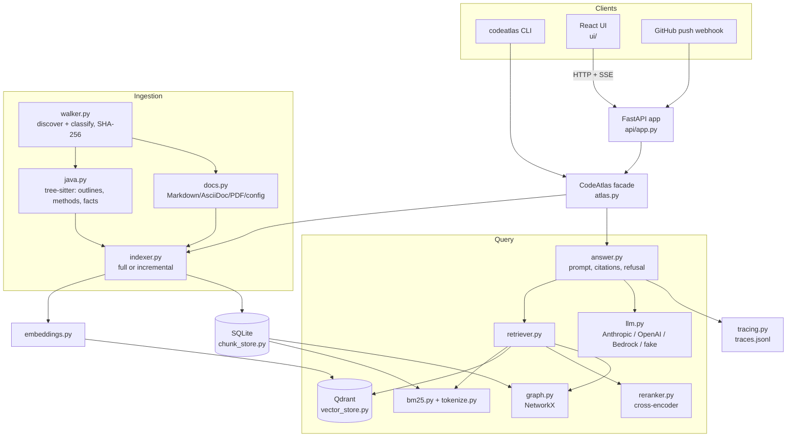

# Architecture

CodeAtlas has two paths. **Ingestion** turns a repository into chunks, vectors and a code graph.
**Query** turns a question into ranked chunks and then a cited answer. Both are plain Python packages,
used by a CLI, an HTTP API and a React UI.

## Components

| Module | Responsibility |
|---|---|
| `ingest/walker.py` | Walk the repository, skip excluded directories, large files and links that resolve outside the repository; classify each file (Java, doc, config, PDF). |
| `ingest/java.py` | Parse Java with tree-sitter. Emit a **class outline** chunk (fields and member signatures) and one chunk per **method**, each with a contextual header: package, Spring stereotype, annotations, resolved HTTP endpoints and outgoing calls. Also emit structural facts (types, methods, calls, field types, endpoints, Lombok and record accessors) for the graph. |
| `ingest/docs.py` | Heading-aware chunks for Markdown/AsciiDoc with breadcrumbs, whole config files, PDFs, and the **naive** fixed-size baseline chunker. |
| `ingest/indexer.py` | Full and incremental indexing: hash every file, re-chunk and re-embed only the files that changed, delete removed files, and record each run (files, chunks, tokens, cost, duration). |
| `storage/chunk_store.py` | SQLite: chunks, file hashes, Java facts, index metadata (embedder, chunker) and run history. |
| `storage/vector_store.py` | Qdrant: embedded on disk (default), in memory, or a server. A lock file stops two processes from opening the same embedded index. |
| `embeddings.py` | Local sentence-transformers (default `bge-small-en-v1.5`), OpenAI, Voyage, or the offline `hashing` embedder used by tests. |
| `retrieval/bm25.py`, `tokenize.py` | In-memory BM25 over chunk text. The tokenizer keeps identifiers whole and also splits camelCase, snake_case and URL paths. |
| `retrieval/retriever.py` | The retrieval pipeline below, configured by a **mode** (`vector`, `bm25`, `hybrid`, plus `+rewrite`, `+rerank`, `+graph`) and ranking options. |
| `retrieval/reranker.py` | Cross-encoder rescoring (default `gte-reranker-modernbert-base`). |
| `graph.py` | Builds a NetworkX graph from the stored facts: calls resolved through field and local-variable types, interface → implementation edges, type references, and endpoint callers. Answers "who depends on X" and writes a citable dependency report. |
| `answer.py` | Builds the prompt with numbered `<block>` elements (escaped, treated as data), streams the answer, validates `[n]` citations, and refuses below the confidence threshold. |
| `llm.py` | One small interface over the Anthropic API, OpenAI(-compatible), Bedrock (Converse API) and the offline `fake` provider. It handles typed errors, retries, timeouts, stop reasons, thinking settings and prices. |
| `eval/` | Evaluation sets, symbol-level scoring, the runner (recall@k, hit@k, MRR, latency, refusal, citations), the LLM judge and the judged-run helpers. |
| `api/app.py` | FastAPI routes (see [api.md](api.md)), bearer-token middleware, SSE streaming with progress heartbeats, and the static UI. |
| `doctor.py` | Environment checks: Python, the index and its lock, the models, and the LLM configuration (names only, never secrets). One optional 1-token LLM call. |
| `tracing.py` | One JSON line per query: spans, latency, tokens, cost, retrieved chunks and confidence. |
| `ui/` | React + TypeScript (Vite). Streaming chat, citations that open a source viewer, a "don't know" card, a per-question `fast` / `quality` switch with a progress bar, and a settings panel. |

## Query path

1. **Candidates.** BM25 and/or vector search each return up to `candidates` (40) chunks. With `+rewrite`,
   an LLM adds up to three identifier-rich queries. Lists are merged with Reciprocal Rank Fusion.
2. **Ranking rules.** Test code (`src/test/**`) ranks below main code unless the question is about tests.
   A class outline ranks below its own methods.
3. **Rerank** (`+rerank`). The cross-encoder rescores the top `rerank_pool` (20) candidates. Its top score,
   through a sigmoid, becomes the **confidence**. Without a reranker, the confidence is the top vector
   similarity.
4. **Graph** (`+graph`). For impact and caller questions, the mentioned classes, methods or endpoints are
   resolved in the graph, their dependents are walked up to `graph_depth` (3) hops, and a dependency report
   is added as a citable block. `graph_slots` (2) of the top k are reserved for graph neighbours. The
   graph never raises the confidence.
5. **Refusal.** If the confidence is below the threshold for that embedder or reranker
   (`min_confidence_by_model`, calibrated on the dev split), the answer is "I don't know based on the
   indexed code." plus the closest matches, and no LLM call is made.
6. **Generation.** The top k blocks go to the LLM with a prompt that requires `[n]` citations and allows an
   "I don't know". Citations to blocks that were not sent are flagged. The stream emits `progress` (every
   5 s while working), `sources`, `token`… and `done`.

## Named setups

Two setups were frozen on the dev split and are the API/UI choices (`CODEATLAS_SETUPS`):

| Setup | Mode | k | Typical latency (CPU) |
|---|---|---|---|
| `fast` (default) | `vector` | 5 | ~30 ms |
| `quality` | `hybrid+rerank+graph` | 5 | ~20–30 s |

## Deployment

One container serves the API and the built UI (`CODEATLAS_UI_DIR`). The `deploy` image target bakes in
the PetClinic index and both models. `infra/terraform` runs it on ECS Fargate behind an ALB and CloudFront,
with Bedrock for generation. See [deploy.md](deploy.md).
